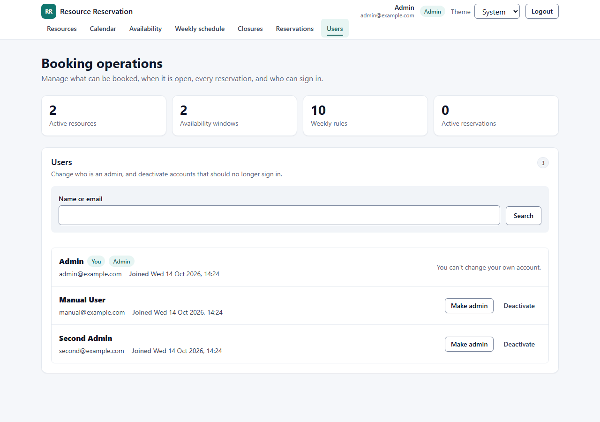
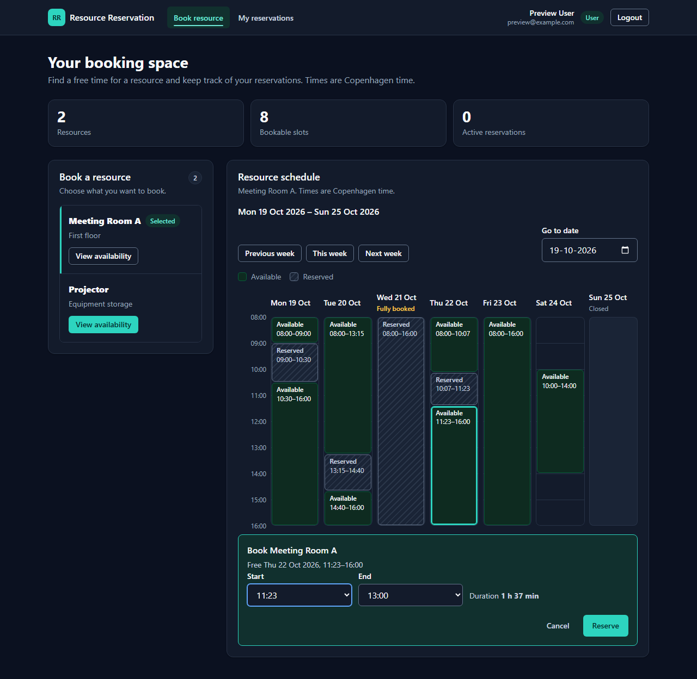
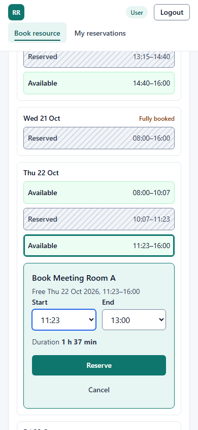

# Resource Reservation System

A finished full-stack MVP for reserving shared resources, built with ASP.NET Core Web API, SQL Server, React, TypeScript, and JWT authentication.

The project is designed as a portfolio project. It demonstrates practical backend development, relational database design, authentication, role-based authorization, frontend integration, validation, and automated verification in a realistic booking workflow.

## MVP Status

This project is complete as an MVP.

The application supports the core flow for a generic resource reservation system:

- Admins manage bookable resources
- Admins define one-off availability windows
- Admins define weekly availability rules, such as Monday to Friday from 08:00 to 16:00
- Users choose a resource first, then view generated bookable times
- Users create, move and cancel their own reservations
- Admins view and manage all reservations
- The backend prevents overlapping active reservations
- Cancelled reservations no longer block new reservations
- Booking rules: shortest and longest booking, notice needed, how far ahead, and how many upcoming bookings each user can hold, with per-resource overrides
- Reservations record when they were made, moved and cancelled, and who cancelled them
- Admins close resources for holidays or maintenance, see the bookings inside first, and move any booking in an admin calendar

The project intentionally stays generic. A resource can represent a meeting room, workspace, vehicle, sports court, equipment item, or another shared asset.

## Screenshots

### Admin Resource Management


### Admin Weekly Schedule


### Admin User Management

Every account, with search. Admins change roles and deactivate accounts, but not their own.



### User Booking Calendar

A week of free and reserved time for one resource, with a time being chosen. A fully booked day stays visible.


<table>
<tr>
<td></td>
<td></td>
</tr>
<tr><td>Dark mode</td><td>On a phone</td></tr>
</table>

### User Reservations


## Features

### Authentication And Authorization

- User registration, confirmed through an emailed link before the account can sign in
- Registration and password reset answer the same whether or not an address has an account
- Password reset from an emailed link, which signs out every device
- User login
- JWT-based authentication
- Session expiry: the frontend returns to the login screen when the token expires or the API rejects it
- Rate-limited login and registration
- Five failed sign-ins lock an account for 15 minutes, without revealing whether the account exists
- Role changes and deactivation end the user's existing sessions at once
- Old password hashes are upgraded when the user signs in
- Role-based access for Admin and User behavior
- Seeded development Admin account

### Admin Features

- Create, edit, and delete resources
- Mark resources active or inactive
- Give a resource its own booking rules, or leave it on the defaults
- Create, edit, and delete one-off availability windows
- Create, edit, and delete weekly availability rules
- Close a resource for a period with a reason, such as a holiday. The bookings inside are shown before saving and are never cancelled automatically; each can be cancelled from the list afterwards. Closures may overlap, and each can be deleted on its own.
- See a resource's week in a calendar with who made each booking, and move a booking by choosing it
- View all reservations, with when each was made, moved and cancelled, and by whom
- Filter reservations by resource and status
- Cancel any active reservation
- List and search users, make users admins or remove the role, and deactivate or reactivate accounts. Deactivated users keep their reservations. There is always at least one active admin, and admins can't change their own account.

### User Features

- View active resources
- Select a resource before choosing a reservation time
- See a weekly calendar of free and reserved time, Monday to Sunday, including fully booked and closed days
- Choose a start and end inside a free period, in 15-minute steps, within the resource's shortest and longest booking
- Move between weeks, or jump to a date. The address keeps the resource and week, so a link opens the same view.
- Create reservations
- View own reservations, with when each was made, moved and cancelled
- Move an upcoming reservation to another free time on the same resource, in the same calendar
- Cancel own active reservations
- An email when a booking is made, moved or cancelled, with a calendar invitation that adds, updates or removes the event

### Backend Rules

- Reservations require an active resource
- Reservation end time must be after start time
- Reservations must start in the future, and follow the booking rules: shortest and longest booking, notice needed and how many days ahead. Resources can override each rule.
- Each user can hold at most 5 upcoming bookings by default, across all resources, even when booking in parallel
- The same rules apply to admins
- Moving a booking follows the same rules as a new one. Moves and cancellations based on an out-of-date copy are rejected with `409 Conflict` (see [ADR 0008](docs/adr/0008-booking-policies-and-reservation-changes.md)).
- Reservations must fit inside the resource's availability, which is its one-off windows and weekly rules merged together. A booking can span adjacent windows, as long as it doesn't cross a gap.
- Active overlapping reservations are rejected with `409 Conflict`, including when the requests arrive at the same moment (see [ADR 0002](docs/adr/0002-reservation-concurrency.md))
- Cancelled reservations do not block new reservations
- Resources with reservation history cannot be deleted and should be marked inactive instead. The database enforces this too.
- Generated schedules cover at most 62 days per request, and only offer time that the booking rules allow
- All times are wall-clock times in one configured time zone, `Europe/Copenhagen` by default (see [ADR 0001](docs/adr/0001-time-zone-convention.md))

### Interface

- A consistent design system with a Light, Dark or System theme, chosen in the header and remembered in the browser ([ADR 0007](docs/adr/0007-design-system.md))
- Calendars reload when the window regains focus and every minute while visible, so other people's bookings show up
- Dates and times in `en-GB` format with a 24-hour clock, always in Copenhagen time
- Validation errors shown beside the field they belong to
- A warning before leaving a form with unsaved changes, which never stands in the way of the session ending
- Keyboard accessible, with a skip link, visible focus, and a confirmation dialog that keeps focus inside it
- Works on desktop and mobile screens

## Tech Stack

### Backend

- ASP.NET Core Web API
- C#
- Entity Framework Core
- SQL Server LocalDB
- JWT authentication
- Swagger / OpenAPI
- xUnit tests

### Frontend

- React
- TypeScript
- Vite
- React Router (routes per screen, protected routes)
- TanStack Query (server data and caching)
- Vitest and React Testing Library unit tests
- Plain CSS with design tokens, light and dark mode
- Playwright smoke tests
- axe-core accessibility checks
- ESLint

### Tooling

- GitHub Actions
- Docker and Docker Compose, with nginx in front of the API
- Visual Studio / .NET CLI
- SQL Server LocalDB
- SQL Server Management Studio

## Project Structure

```text
backend/
  ResourceReservation.Api/
    Controllers/
    Data/
    DTOs/
    Migrations/
    Models/
    Services/

  ResourceReservation.Api.Tests/
  ResourceReservation.Api.IntegrationTests/
  Dockerfile       the API and migrator images

frontend/
  resource-reservation-client/
    Dockerfile     the nginx image with the built frontend
    nginx/         nginx config: TLS, proxy, security headers
    scripts/       build helpers, such as the CSP hash of the inline script
    src/
      api/         typed API calls and the shared client
      app/         routes, layouts, route guards, query client
      auth/        session storage, auth provider, login page
      components/  app sections: forms, lists, tabs, confirmation provider
      features/    one folder per feature: pages and query hooks
      lib/         pure helpers and query keys
      styles/      design tokens and base styles
      ui/          design-system components with their stylesheets
    tests/
      smoke/

deploy/
  sql/             the API's SQL login, created by compose
  create-dev-certificate.sh
  smoke-test.sh    checks a running compose stack through nginx

compose.yaml       the whole system in Docker Compose
.env.example       compose settings; copy to .env, which git ignores

docs/
  adr/             architecture decision records
  audit/           project audits
  architecture.md  layers, request flow, data model and frontend diagrams
  deployment.md    Docker Compose, HTTPS, the reverse proxy and releases
  testing.md       test suites, how to run them, and coverage
  planning.md
  roadmap.md
```

## Architecture Overview

The application is split into a backend API, a SQL Server database, and a React frontend. Diagrams of the layers, the reservation flow and the data model are in [docs/architecture.md](docs/architecture.md).

The backend owns the business rules. It exposes endpoints for authentication, resources, availability windows, weekly availability rules, generated resource schedules, and reservations.

SQL Server stores users, resources, availability windows, weekly rules, and reservations. Entity Framework Core maps the C# models to database tables and manages migrations.

The frontend provides role-based workflows. Admin users manage the booking setup. Normal users select a resource, view generated availability, and reserve a valid time slot.

## Domain Model

- `User` - a person who can log in and create reservations, as a User or an Admin. An admin can deactivate an account, which keeps its reservations.
- `Resource` - something that can be reserved
- `Availability` - a one-off date/time window where a resource can be booked
- `AvailabilityRule` - a recurring weekly rule for a resource, such as Monday 08:00-16:00
- `Reservation` - a concrete booking made by a user for a resource

## API Overview

### Auth

```text
POST /api/auth/register                202, the same answer for every address
POST /api/auth/login
POST /api/auth/resend-verification     202, the same answer for every address
POST /api/auth/verify-email            { token, password }
POST /api/auth/forgot-password         202, the same answer for every address
POST /api/auth/reset-password/check    { token }: whether the link still works
POST /api/auth/reset-password          { token, password, name? }
```

Registration creates an unconfirmed account and emails a link, or emails a notice if the address already has an account. An unconfirmed account can't sign in (`403` after the right password) until `verify-email` is called with the link's token and the account's password. A password reset ends every session. Links work once and expire after 24 hours (verification) or 1 hour (reset). See [ADR 0011](docs/adr/0011-email-flows.md).

Login returns the token, `expiresAt` (UTC) and `expiresInSeconds`. Clients should time the session from `expiresInSeconds`, because their own clock may be wrong.

Login, verification and reset share a rate limit per client IP address, using a token bucket:
- A client starts with 10 attempts, then gets one more every 6 seconds, up to 10. That allows 10 attempts per minute sustained, with a burst of up to about 20 in the first minute.
- Over the limit, the API returns `429` with `Retry-After: 6`, the refill interval. That isn't the time left, so the next attempt may be allowed sooner.

Five failed sign-ins in a row lock the account for 15 minutes. Every failure, including an unknown email or a locked account, returns the same `401` and message. A deactivated account gets `403` only after the right password. Every authenticated request checks that the token's user is still active, with the same role and security stamp ([ADR 0010](docs/adr/0010-user-management-and-account-security.md)).

Registration, resend-verification and forgot-password share a stricter limit of their own: 5 requests, then one every 3 minutes. Each account also gets at most one email of each kind every 2 minutes.

See [security](docs/security.md#brute-force-protection).

### Users

```text
GET /api/users?search=&page=1&pageSize=25   Admin only: accounts, paged and searchable by name or email
PUT /api/users/{id}/role                    Admin only: { "role": "User" | "Admin" }
PUT /api/users/{id}/status                  Admin only: { "isActive": true | false }
```

Changing a role or deactivating an account ends the user's existing sessions. Admins can't change their own account (`403`), and a change that would leave no active admin returns `409`. Concurrent changes wait for each other under a SQL Server application lock, and a timeout returns `503` with `Retry-After`.

### Health

```text
GET /health/live    The process is running. Checks nothing else.
GET /health/ready   The API can reach its database. Returns 503 if not.
```

Both are anonymous and return only `Healthy` or `Unhealthy`.

### Resources

```text
GET    /api/resources
GET    /api/resources/{id}
GET    /api/resources/{id}/schedule?from=YYYY-MM-DD&to=YYYY-MM-DD   max 62 days
POST   /api/resources        Admin only
PUT    /api/resources/{id}   Admin only
DELETE /api/resources/{id}   Admin only
GET    /api/bookingpolicy    Logged-in user: the default booking rules
```

The schedule is public. It lists bookable and reserved times, but nothing that identifies a reservation or who made it. It only offers time the resource's booking rules allow, and includes those rules as `policy`.

Adding `&excludeReservationId={id}` leaves that reservation out, so its own time shows as free while it is being moved. That needs the reservation's owner or an admin.

Resources have four optional booking rule overrides: `minDurationMinutes`, `maxDurationMinutes`, `minLeadTimeMinutes` and `maxAdvanceDays`. `null` means the resource uses the default from [configuration](docs/configuration.md#booking-rules).

### Closures

```text
GET    /api/availabilityexceptions?resourceId=   Admin only
POST   /api/availabilityexceptions/preview       Admin only: the active reservations inside, nothing saved
POST   /api/availabilityexceptions               Admin only: the closure, and the reservations inside it
DELETE /api/availabilityexceptions/{id}          Admin only
```

A closure (`resourceId`, `startTime`, `endTime`, `reason`) takes time out of a resource's availability, so it can't be booked or moved into. Reservations already inside stay active. The schedule shows closed time as `closedSlots`, with each reason, to everyone. Creating a closure takes the resource's booking lock, so the list of affected reservations it returns is complete ([ADR 0009](docs/adr/0009-availability-exceptions.md)).

### Availability Windows

```text
GET    /api/availabilities
GET    /api/availabilities/{id}
POST   /api/availabilities        Admin only
PUT    /api/availabilities/{id}   Admin only
DELETE /api/availabilities/{id}   Admin only
```

### Weekly Availability Rules

```text
GET    /api/availabilityrules
GET    /api/availabilityrules/{id}
POST   /api/availabilityrules        Admin only
PUT    /api/availabilityrules/{id}   Admin only
DELETE /api/availabilityrules/{id}   Admin only
```

### Reservations

```text
GET /api/reservations                    Admin only
GET /api/reservations/{id}               Owner or Admin
GET /api/reservations/me                 Logged-in user
POST /api/reservations                   Logged-in user
PUT /api/reservations/{id}               Owner or Admin: move to a new time
PUT /api/reservations/{id}/cancel        Owner or Admin
GET /api/reservations/resource/{id}      Admin only, optionally ?from=YYYY-MM-DD&to=YYYY-MM-DD
GET /api/reservations/user/{id}          Admin only
```

Reservation responses include the owner's `userName` and `userEmail`. Every reservation endpoint is limited to the owner or an admin.

They also include:
- `createdAt`, `updatedAt`, `cancelledAt` and `cancelledByName`: UTC times with an offset, or `null` for reservations made before they were recorded.
- `version`: send it back when moving (`{ startTime, endTime, version }`, required) or cancelling (`{ version }`, optional). If the reservation changed in the meantime, the API returns `409 Conflict` instead of overwriting the change.

A booking can only be moved on its own resource, before it starts. The new time follows the same rules as a new booking. See [ADR 0008](docs/adr/0008-booking-policies-and-reservation-changes.md).

### Errors

Every error is returned as [RFC 9457 problem details](https://www.rfc-editor.org/rfc/rfc9457) with the content type `application/problem+json`. `detail` explains the problem, and `traceId` matches the server logs:

```json
{
  "type": "https://tools.ietf.org/html/rfc9110#section-15.5.10",
  "title": "Conflict",
  "status": 409,
  "detail": "Resource is already reserved in this time period.",
  "traceId": "00-4bf92f3577b34da6a3ce929d0e0e4736-00f067aa0ba902b7-00"
}
```

Validation errors also include `errors`, keyed by field name. Unexpected server errors return a `500` with no internal details.

| Status | Meaning |
|---|---|
| `400` | Invalid input, or a business rule was broken (for example, outside availability or in the past) |
| `401` | Missing or invalid token |
| `403` | Authenticated, but not allowed |
| `404` | Resource, availability or reservation not found |
| `409` | The time overlaps an active reservation |
| `429` | Too many login or registration attempts. `Retry-After` gives the refill interval in seconds. |
| `503` | Another booking for the same resource is in progress. Retry after the number of seconds in the `Retry-After` header. |

## Run With Docker Compose

The quickest way to run the whole system: SQL Server, migrations, the API, and nginx serving the frontend over HTTPS. You need Docker and `openssl`, which comes with Git Bash on Windows.

```bash
cp .env.example .env    # fill in the three secrets and the seed admin
sh deploy/create-dev-certificate.sh
docker compose up --build
```

Then open <https://localhost:8443> and accept the self-signed certificate, or create a trusted one with mkcert. `sh deploy/smoke-test.sh` checks the running stack. Until real email delivery arrives in Milestone 7, emails are written to a volume.

[docs/deployment.md](docs/deployment.md) explains the setup, how to read the emails, and how to run it on a server.

## Local Setup

For development, run the API and the Vite dev server directly.

### Prerequisites

- .NET SDK matching the project target framework
- Node.js
- SQL Server LocalDB
- Docker Desktop (for the integration tests and Docker Compose)

### Backend

From the repository root:

```bash
dotnet restore ResourceReservationSystem.slnx
dotnet tool restore
dotnet ef database update --project backend/ResourceReservation.Api --startup-project backend/ResourceReservation.Api
dotnet run --project backend/ResourceReservation.Api/ResourceReservation.Api.csproj
```

`dotnet ef database update` also applies new migrations to an existing database. Migrations are written to keep existing data. `dotnet tool restore` installs the pinned `dotnet-ef` version.

Swagger is available in development at:

```text
http://localhost:5052/swagger
```

Development connection string:

```text
Server=(localdb)\MSSQLLocalDB;Database=ResourceReservationDb;Trusted_Connection=True;TrustServerCertificate=True
```

### Development Admin User

The development Admin user is seeded from `appsettings.Development.json`:

```json
"SeedAdmin": {
  "Name": "Admin",
  "Email": "admin@example.com",
  "Password": "Admin1234"
}
```

### Emails In Development

In Development, emails aren't sent. Each one is written as an `.eml` file to `backend/ResourceReservation.Api/.dev-emails/`, which git ignores. Open a file in any mail client, or as text, to follow a verification or reset link, or to see a booking email and its calendar invitation. The links point at `http://localhost:5173`, set by `Frontend:BaseUrl`.

The seeded admin and accounts that existed before email verification are already confirmed.

### Frontend

Start the backend first. Then run:

```bash
cd frontend/resource-reservation-client
npm install
npm run dev
```

The Vite development server usually runs at:

```text
http://localhost:5173
```

The frontend expects the API at:

```text
http://localhost:5052/api
```

This can be overridden with `VITE_API_BASE_URL`.

## Verification

Backend tests:

```bash
dotnet test ResourceReservationSystem.slnx
```

This runs two suites:

- `ResourceReservation.Api.Tests`: fast unit tests of the controllers, using the EF Core in-memory provider.
- `ResourceReservation.Api.IntegrationTests`: the whole API over HTTP against a real SQL Server, started in Docker with [Testcontainers](https://dotnet.testcontainers.org/). They cover authorization, validation, booking concurrency, the unique email and the migrations.

See [docs/testing.md](docs/testing.md) for what each suite covers and how to produce a coverage report.

Further documentation:
- [architecture](docs/architecture.md)
- [configuration](docs/configuration.md)
- [security](docs/security.md)
- [deployment](docs/deployment.md)
- [decision records](docs/adr/)

The integration tests need **Docker Desktop** to be running. To use an existing SQL Server instead, set `INTEGRATION_TEST_CONNECTION_STRING`. The database name must end in `_IntegrationTests`, because the tests delete all of its data between runs.

Frontend checks:

```bash
cd frontend/resource-reservation-client
npm run lint
npm run build
npm run test:smoke
```

The Playwright smoke tests cover the main browser flow: Admin login, resource management, weekly schedule management, availability management, User registration/login, resource-first booking, moving a booking, reservation cancellation, closures, the admin calendar, the theme switch, and overlap error handling.

## Continuous Integration

GitHub Actions runs on push and pull request.

The workflow runs four jobs, with a token that can only read the repository:

- **Backend:** restores and tests the backend, and reports coverage.
- **Migration bundle:** builds the migration bundle, applies it to an empty SQL Server, and uploads it.
- **Frontend:** installs dependencies, runs lint, builds the frontend, and runs the Playwright smoke tests.
- **Container stack:** builds the three images, starts the whole system with Docker Compose, and runs `deploy/smoke-test.sh` against it.

Pull requests fail if any check fails.

## Configuration

The API checks its settings at startup and stops with a message naming any setting that is missing or invalid. Settings can come from `appsettings.*.json`, user secrets, or environment variables. In environment variable names, `:` becomes `__`, so `Jwt:Key` is set as `Jwt__Key`.

| Setting | Required | Default |
|---|---|---|
| `ConnectionStrings:DefaultConnection` | Yes | None |
| `Jwt:Key`, `Jwt:Issuer`, `Jwt:Audience` | Yes | None |
| `Jwt:ExpiryMinutes` | No | `120` |
| `Scheduling:TimeZoneId` | Yes | `Europe/Copenhagen` |
| `Scheduling:BookingLockTimeoutMilliseconds` | No | `10000` |
| `BookingPolicy:MinDurationMinutes`, `BookingPolicy:MaxDurationMinutes` | No | `15`, `480` |
| `BookingPolicy:MinLeadTimeMinutes`, `BookingPolicy:MaxAdvanceDays` | No | `0`, `90` |
| `BookingPolicy:MaxActiveReservationsPerUser` | No | `5` |
| `Cors:AllowedOrigins` | No | None |
| `ReverseProxy:KnownProxies`, `ReverseProxy:KnownNetworks` | No | None |
| `RateLimiting:Auth:PermitLimit`, `RateLimiting:Auth:WindowSeconds` | No | `10`, `60` |
| `SeedAdmin:Email`, `SeedAdmin:Password`, `SeedAdmin:Name` | No | None |

[docs/configuration.md](docs/configuration.md) explains every setting, its limits, which values are secrets, and which environment variables to leave unset. `appsettings.Development.json` contains working values for local development only.

## Deployment Notes

This project is prepared as a portfolio application and isn't hosted. It is deploy-ready with Docker Compose ([docs/deployment.md](docs/deployment.md)):

- **One origin:** nginx serves the frontend and passes `/api` and `/health` to the API, so there are no cross-origin requests.
- **HTTPS at nginx,** also on your own machine. Plain HTTP only redirects.
- **Trusted proxy:** the API trusts forwarded headers only from nginx's fixed address.
- **Security headers for the frontend,** including a strict Content-Security-Policy that allows the inline theme script by its hash.
- **Caching:** hashed assets are cached as immutable, and `index.html` is always revalidated.
- **Migrations:** a one-shot container runs the migration bundle before the API starts. The API never migrates the database itself.
- **Least privilege:** the API connects with its own SQL login, which can't change the schema. Every container but SQL Server runs as a non-root user.
- **Only nginx publishes ports.** SQL Server and the API are reachable only on private networks.
- **Secrets** come from `.env`, which git ignores. Images contain none.

Before any public deployment, Milestone 7 still moves the session to an httpOnly cookie and adds real email delivery ([roadmap](docs/roadmap.md#m7-deployment)).

Outside Docker, the same rules apply: use SQL Server, which reservation locking needs (`sp_getapplock`); apply the migration bundle before each release; keep secrets in the hosting environment; list the reverse proxy in `ReverseProxy:KnownProxies`; and build the frontend with `VITE_API_BASE_URL` pointing at the API.

## Roadmap

The MVP has been audited for production readiness. See the [audit](docs/audit/2026-10-initial-audit.md) and the milestone [roadmap](docs/roadmap.md).

## Potential Future Improvements

These are intentionally outside the finished MVP, but would make good future issues:

- Resource categories and filtering
- Better calendar controls for week/month navigation
- Admin analytics or utilization overview
- Hosted production deployment
- Multi-tenant organization support

## Portfolio Notes

This project is meant to show a complete, understandable MVP rather than an oversized production system.

It demonstrates:

- Full-stack feature development
- API design with DTOs
- Entity Framework Core migrations
- SQL Server persistence
- Authentication and authorization
- Business-rule validation
- Frontend state management
- Automated backend and frontend verification
