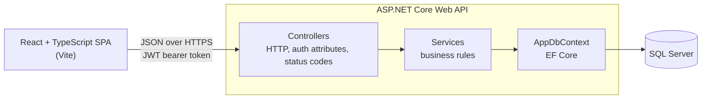
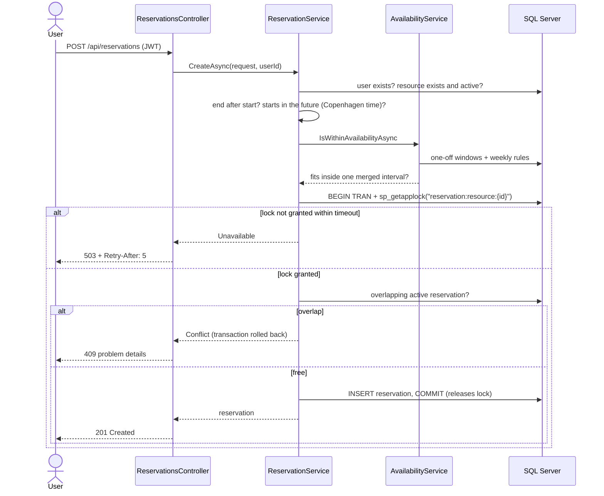
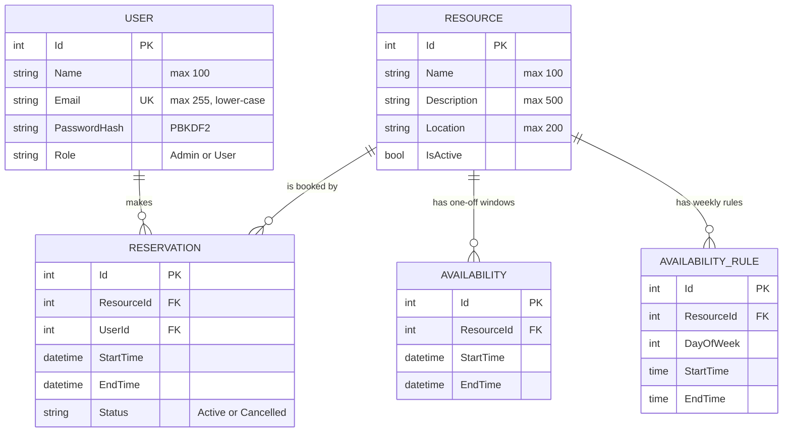

# Architecture

The Resource Reservation System is a React single-page app backed by an ASP.NET Core Web API and SQL Server. The API owns every business rule. The frontend only presents data and collects input.

## System overview

## Backend layers

| Layer | Folder | Responsibility |
|---|---|---|
| Controllers | `Controllers/` | Routing, `[Authorize]` rules, reading the current user from the token, and turning service results into HTTP responses |
| Services | `Services/` | Business rules: availability, booking, cancellation, authentication, tokens and scheduling time |
| Data | `Data/`, `Models/`, `Migrations/` | EF Core model, database constraints and migrations |
| Contracts | `DTOs/` | Request and response shapes, with DataAnnotations validation |
| Configuration | `Configuration/` | Typed settings, validated when the app starts |

### Services return results, not exceptions

Services return `ServiceResult<T>`, which holds either a value or a `ServiceError`. The error has a kind (`Validation`, `Unauthorized`, `NotFound`, `Forbidden`, `Conflict` or `Unavailable`) and a message.

One controller extension, `ToErrorResult`, maps each kind to an HTTP status and an RFC 9457 problem details response. Exceptions are kept for real bugs. The global exception handler logs them and returns a 500 that leaks no internal details. See [ADR 0003](adr/0003-error-handling.md).

Services get the caller as a plain `CurrentUser(UserId, IsAdmin)` value, so they never depend on HTTP.

### Thin CRUD controllers

`ResourcesController`, `AvailabilitiesController` and `AvailabilityRulesController` still call EF Core directly. Their logic is simple create, read, update and delete with small overlap checks, so a service layer for them would add files without adding value. They return errors through the same `ToErrorResult` helper, so every error response has the same shape.

## Creating a reservation

The most important flow. The per-resource lock is what prevents double-booking ([ADR 0002](adr/0002-reservation-concurrency.md)).

## Data model

The database enforces the integrity rules as well:

- a unique, normalised email
- a check constraint on reservation status
- an index for the overlap query
- `RESTRICT` on reservation foreign keys, so deleting a user or resource can never remove booking history

All times are wall-clock times in the configured scheduling time zone, `Europe/Copenhagen` ([ADR 0001](adr/0001-time-zone-convention.md)).

## Cross-cutting concerns

| Concern | How it works |
|---|---|
| Authentication | JWT bearer tokens signed with HMAC-SHA256. They last `Jwt:ExpiryMinutes` (120 by default). |
| Authorization | `[Authorize]` and `[Authorize(Roles = "Admin")]` on controllers. Services check ownership. |
| Errors | RFC 9457 problem details for every error, with `traceId` |
| Configuration | Typed options validated at startup. See the configuration table in the README. |
| Time | `SchedulingClock` gives "now" in the scheduling time zone, through an injectable `TimeProvider` |

## Frontend

The frontend is a Vite-built React and TypeScript app:

- `src/api/` holds the typed API clients. `client.ts` adds the bearer token and turns problem details into readable messages.
- `src/views/` holds the admin and user screens.
- `src/components/` holds the screen sections.
- State currently lives in `App.tsx`. Splitting it into feature hooks, and adding routing, is planned for Milestone 4 ([roadmap](roadmap.md)).

## Decision records

- [ADR 0001: Store times as wall-clock time in one configured time zone](adr/0001-time-zone-convention.md)
- [ADR 0002: Serialize bookings per resource with a SQL Server application lock](adr/0002-reservation-concurrency.md)
- [ADR 0003: Problem details for errors and result types for expected failures](adr/0003-error-handling.md)
