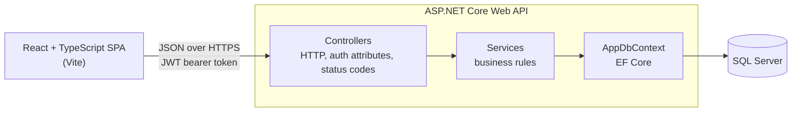
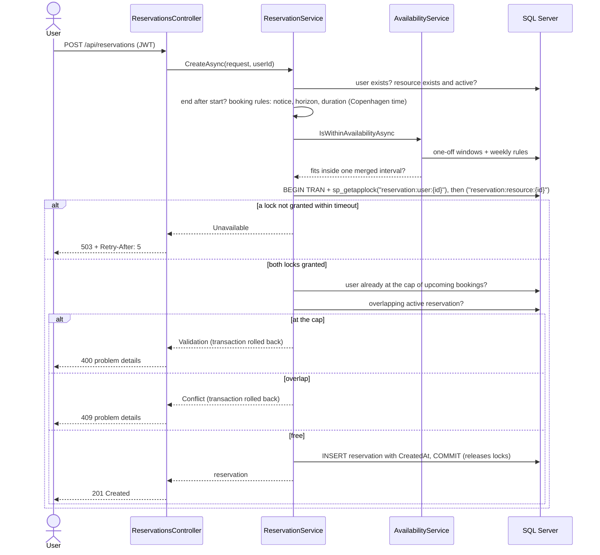
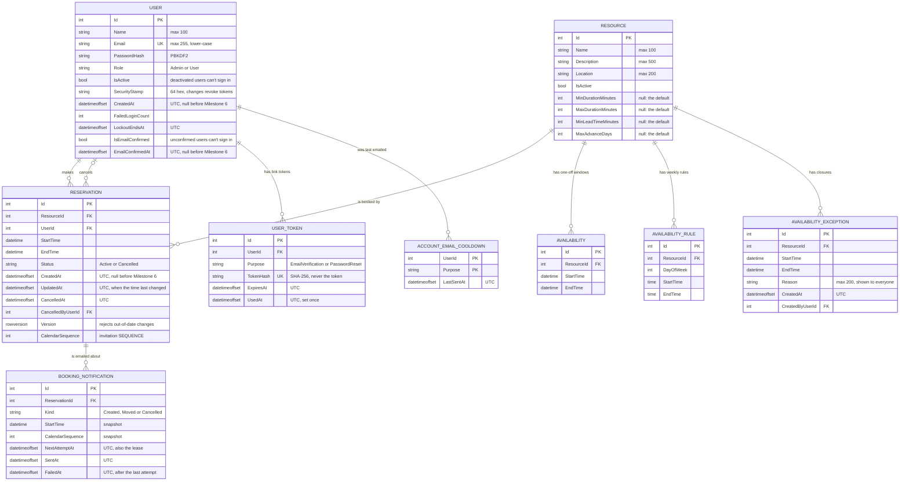
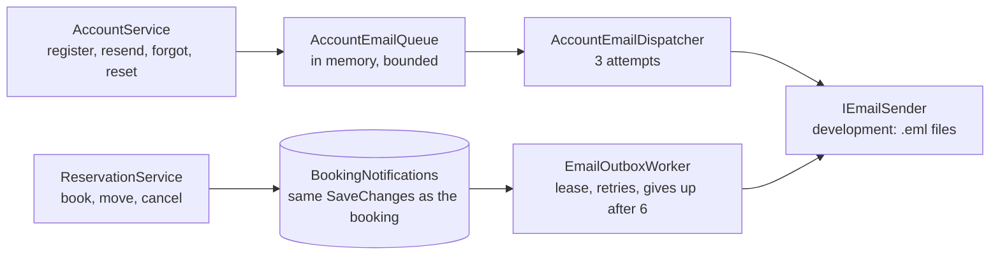
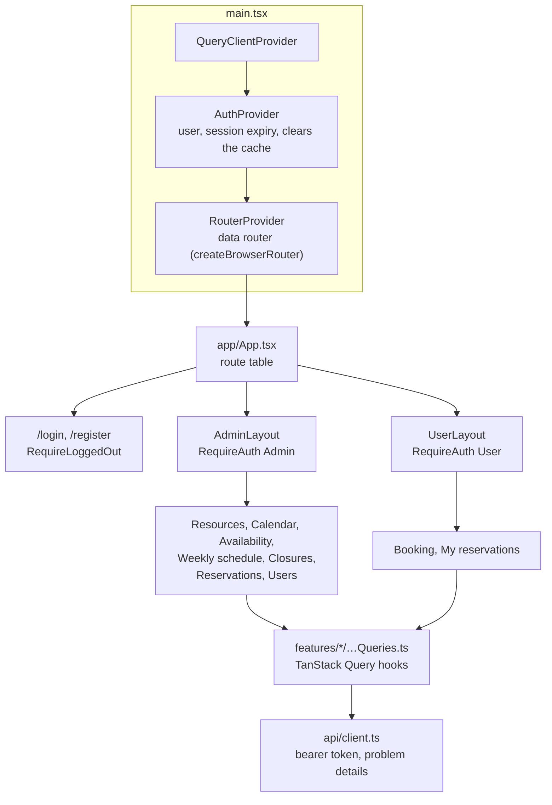

# Architecture

The Resource Reservation System is a React single-page app backed by an ASP.NET Core Web API and SQL Server. The API owns every business rule. The frontend only presents data and collects input.

## System overview

## Backend layers

| Layer | Folder | Responsibility |
|---|---|---|
| Controllers | `Controllers/` | Routing, `[Authorize]` rules, reading the current user from the token, and turning service results into HTTP responses |
| Services | `Services/` | Business rules: availability and closures, booking policies, booking, moving and cancellation, the application locks, authentication with lockout, token checks, user management, account emails and link tokens, the booking email outbox, and scheduling time |
| Data | `Data/`, `Models/`, `Migrations/` | EF Core model, database constraints and migrations |
| Contracts | `DTOs/` | Request and response shapes, with DataAnnotations validation |
| Configuration | `Configuration/` | Typed settings, validated when the app starts |

### Services return results, not exceptions

Services return `ServiceResult<T>`, which holds either a value or a `ServiceError`. The error has a kind (`Validation`, `Unauthorized`, `NotFound`, `Forbidden`, `Conflict` or `Unavailable`) and a message.

One controller extension, `ToErrorResult`, maps each kind to an HTTP status and an RFC 9457 problem details response. Exceptions are kept for real bugs. The global exception handler logs them and returns a 500 that leaks no internal details. See [ADR 0003](adr/0003-error-handling.md).

Services get the caller as a plain `CurrentUser(UserId, IsAdmin)` value, so they never depend on HTTP.

### Thin CRUD controllers

`ResourcesController`, `AvailabilitiesController` and `AvailabilityRulesController` still call EF Core directly. Their logic is simple create, read, update and delete with small overlap checks, so a service layer for them would add files without adding value. They return errors through the same `ToErrorResult` helper, so every error response has the same shape.

## Creating a reservation

The most important flow. The per-resource lock is what prevents double-booking, and the per-user lock keeps the cap on upcoming bookings ([ADR 0002](adr/0002-reservation-concurrency.md)). The booking rules come from `BookingPolicy`, which the schedule uses too ([ADR 0008](adr/0008-booking-policies-and-reservation-changes.md)).

Availability is checked after the locks are taken, so a closure saved while the booking waited is seen. Creating a closure takes the same resource lock, through the shared `BookingLocks` service ([ADR 0009](adr/0009-availability-exceptions.md)).

Moving a booking (`PUT /api/reservations/{id}`) follows the same steps, with three differences:

- It first checks the `version` the client sent.
- It takes only the resource lock.
- It ignores the booking's own old time when checking for overlaps.

The `UPDATE` includes the `rowversion` read with the booking, so a change saved by someone else in between returns 409 rather than being overwritten. Cancelling works the same way.

## Data model

The database enforces the integrity rules as well:

- a unique, normalised email
- a check constraint on reservation status
- a check constraint that keeps resource booking rule overrides in range, with the minimum duration no longer than the maximum
- a check constraint that a closure ends after it starts
- an index for the overlap query
- `RESTRICT` on reservation foreign keys, so deleting a user or resource can never remove booking history

Booking and availability times are wall-clock times in the configured scheduling time zone, `Europe/Copenhagen` ([ADR 0001](adr/0001-time-zone-convention.md)). Reservation audit times are UTC instants.

## Cross-cutting concerns

| Concern | How it works |
|---|---|
| Authentication | JWT bearer tokens signed with HMAC-SHA256. They last `Jwt:ExpiryMinutes` (120 by default). Every request also checks the token's user is still active with the same role and security stamp. Five failed sign-ins lock an account for 15 minutes. See [ADR 0010](adr/0010-user-management-and-account-security.md). |
| Authorization | `[Authorize]` and `[Authorize(Roles = "Admin")]` on controllers. Services check ownership. Role and status changes run under an application lock that keeps an active admin. |
| Errors | RFC 9457 problem details for every error, with `traceId` |
| Configuration | Typed options validated at startup. See [configuration](configuration.md). |
| Security | Rate-limited login and registration, CORS, trusted proxies, security headers and HSTS. See [security](security.md). |
| Health | `/health/live` and `/health/ready` for the hosting platform. See [deployment](deployment.md#health-checks). |
| Time | `SchedulingClock` gives "now" in the scheduling time zone, through an injectable `TimeProvider` |
| Email | Account emails (links and notices) go through a bounded in-memory queue; booking emails through a database outbox written with the booking. Both are sent by background services through `IEmailSender`. See below and [ADR 0011](adr/0011-email-flows.md). |

## Email delivery

- **Account emails** carry single-use links, which must never be stored or logged, so they stay in memory. A restart loses what is queued, and the user asks again.
- **Booking emails** are saved with the booking change, so they exist exactly when the change does. A failed email never undoes a booking.
- **Calendar invitations:** each booking email has an `.ics` file with a stable UID and a rising SEQUENCE, so calendars update or remove one event.

## Request pipeline

Middleware runs in this order for every request:

1. **Forwarded headers:** only when trusted proxies are configured. They set the real client IP address and scheme.
2. **Exception handler:** turns unhandled exceptions into a 500 problem response.
3. **HSTS:** outside Development only.
4. **Security headers:** added when the response starts, so they're present on every response.
5. **Swagger:** Development only.
6. **HTTPS redirection**
7. **CORS**
8. **Rate limiter:** after CORS, so the browser can read a 429. It only applies to the auth endpoints.
9. **Authentication and authorization:** after the token's signature and lifetime, `UserSessionValidator` checks its user in the database.
10. **Endpoints:** the controllers and health checks.

## Frontend

The frontend is a Vite-built React and TypeScript app. Routing uses React Router, server data uses TanStack Query, and each feature owns its screens and state ([ADR 0006](adr/0006-frontend-routing-and-state.md)).

| Folder | Contents |
|---|---|
| `src/app/` | The route table, the two layouts, route guards, the not-found page and the query client defaults |
| `src/auth/` | Session storage, `AuthProvider` and `useAuth`, the login and registration page, and the pages email links open: confirming an address and resetting a password |
| `src/features/` | One folder per feature: `resources`, `availability`, `weekly-schedule`, `closures`, `reservations`, `booking`, `users`. Each has its page components and its query hooks. |
| `src/components/` | App-specific sections built from `src/ui/`: forms, lists, the tabs, and `ConfirmProvider` |
| `src/ui/` | The design system's components: `Button`, `Field`, `Card`, `Alert`, `Badge`, `ConfirmDialog` and others, each with its stylesheet |
| `src/styles/` | Design tokens (`tokens.css`) and element defaults (`base.css`) |
| `src/lib/` | Pure helpers: dates, the calendar model, validation, errors, navigation, query keys |
| `src/api/` | Typed API calls and the shared `client.ts` |

How state is handled:

- **Server data** is cached by query key. Each change invalidates the data it affects and resolves once the data on screen has reloaded. For example, cancelling a reservation refreshes the reservation lists and the booking schedules.
- **Logging in or out**, or a session expiring, clears the cache.
- **Filters and the booking selection** live in the address, such as `/book?resource=3&week=2030-01-14` or `/admin/users?search=ada&page=2`. A reload or a shared link shows the same view, and invalid values are ignored. Links from before the calendar, with `from` and `to`, open the week of their `from` date. Moving a booking adds `&move=42`.
- **Cancelling and moving** send the reservation's `version`, and reload the lists and calendars whether they succeed or not, so a 409 for an out-of-date copy leaves fresh data on screen.
- **Form drafts and messages** belong to the page that shows them.
- **Redirects around login and logout** are made only by the route guards (`RequireAuth`, `RequireLoggedOut`), and `returnTo` must be a path inside the app.

### Design system

Styles are plain CSS. Colours, spacing, type, radii and shadows are custom properties in `styles/tokens.css`, with a dark theme. Each component in `src/ui/` has its own stylesheet and uses only tokens ([ADR 0007](adr/0007-design-system.md)).

- **Forms** use `Field`, which links the label, hint and error to the control. API validation errors are shown beside their fields: `ApiError.fieldErrors` holds the first message for each field, and `getFormErrors` splits them from messages for the whole form. After a failed submit, focus moves to the first invalid field.
- **Messages** are `Alert`s with a tone. Errors are announced at once (`role="alert"`), other messages politely (`role="status"`).
- **The confirmation dialog** follows the WAI-ARIA alert dialog pattern, and the page behind it is inert.
- **The layout** has a skip link to `<main id="main-content">`, one `h1` per page, and a document title for the current screen.
- **Theme:** Light, Dark or System, chosen in the header and saved in the browser. An inline script in `index.html` applies it before the page draws.
- **Dates** come from `lib/dates.ts` in `en-GB` with a 24-hour clock, read from the API's wall-clock text rather than through the browser's time zone.

### Booking calendar

`/book` shows a Monday-to-Sunday week for one resource.

- **The model** (`lib/calendar.ts`) is pure and unit tested. It turns the schedule into seven days of free and reserved segments at their exact minutes, split at midnight. Each day is open, fully booked, closed or past: the API leaves out time that has gone but still returns past reservations, so past days are marked rather than shown as fully booked.
- **Times to choose** come in 15-minute steps, plus the exact edges of the free period, because an existing reservation can end at any minute. Only starts and ends within the resource's shortest and longest booking are offered, from the rules the schedule returns. The page describes the rules in a sentence. All arithmetic is on wall-clock minutes, as in [ADR 0001](adr/0001-time-zone-convention.md).
- **Closed time** from closures shows as a third kind of period, with each reason. A day without free time is fully booked only if bookings fill it, otherwise closed. A booking that a later closure covers is drawn beside the closure.
- **Freshness:** the calendar reloads when the window regains focus and every minute while visible ([ADR 0006](adr/0006-frontend-routing-and-state.md#updates)). The query key stays the same, so the resource, the week and a time being chosen are kept.
- **The admin calendar** (`/admin/calendar`) is the same page as an admin variant. Reserved periods come from the admin-only reservations of that week, with who booked them; choosing one opens move mode for it. Free time can only be chosen while moving. The user calendar never asks for owner details.
- **Move mode** (`&move=42`, opened from My reservations) shows the booking instead of the resource list. It loads the schedule without that booking, so its own time shows as free. Afterwards the page returns to ordinary booking in the same week and says where the booking went. A notice belongs to the address it was shown for, which is how "Booking moved" survives that change of address.
- **The view** (`BookingCalendar`) is one labelled section per day with its periods in order. On wide screens CSS places them on an hour grid; under 760 px it is a list of days, and the booking form opens inside the chosen day.
- **A clash** (409) with a booking made meanwhile reloads the calendar and says so.

### Unsaved changes

The routes run in a data router (`createBrowserRouter`), only so that forms can block navigation ([ADR 0006](adr/0006-frontend-routing-and-state.md)). `useUnsavedChangesGuard(hasUnsavedChanges)`:

- asks with the confirmation dialog before moving to another screen, including with the back button, and lets the browser ask before a reload or closing the tab
- compares each form with the values it started from, empty or the item being edited
- never blocks the session ending: an expired session or a logout clears the user, which turns the guard off, and `RequireAuth` unmounts the screen before redirecting
- doesn't block changes within the same screen, such as filters or the week in the address

## Decision records

- [ADR 0001: Store times as wall-clock time in one configured time zone](adr/0001-time-zone-convention.md)
- [ADR 0002: Serialize bookings per resource with a SQL Server application lock](adr/0002-reservation-concurrency.md)
- [ADR 0003: Problem details for errors and result types for expected failures](adr/0003-error-handling.md)
- [ADR 0004: Keep the token in localStorage and handle session expiry in the frontend](adr/0004-token-storage-and-session-expiry.md)
- [ADR 0005: Database migrations as a separate deployment step](adr/0005-migrations-in-deployment.md)
- [ADR 0006: Frontend routing and server state](adr/0006-frontend-routing-and-state.md)
- [ADR 0007: Plain CSS with design tokens and shared components](adr/0007-design-system.md)
- [ADR 0008: Booking policies, rescheduling and reservation history](adr/0008-booking-policies-and-reservation-changes.md)
- [ADR 0009: Closures (availability exceptions)](adr/0009-availability-exceptions.md)
- [ADR 0010: User management and account security](adr/0010-user-management-and-account-security.md)
- [ADR 0011: Email verification, password reset and booking emails](adr/0011-email-flows.md)
