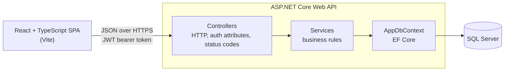
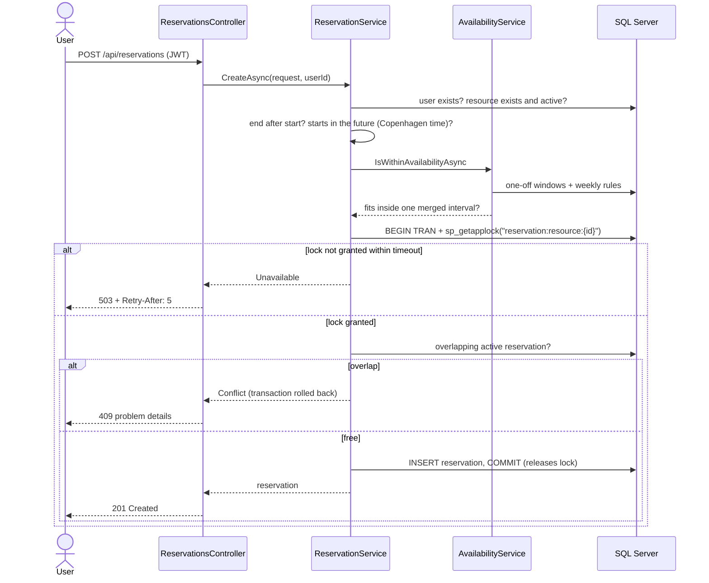
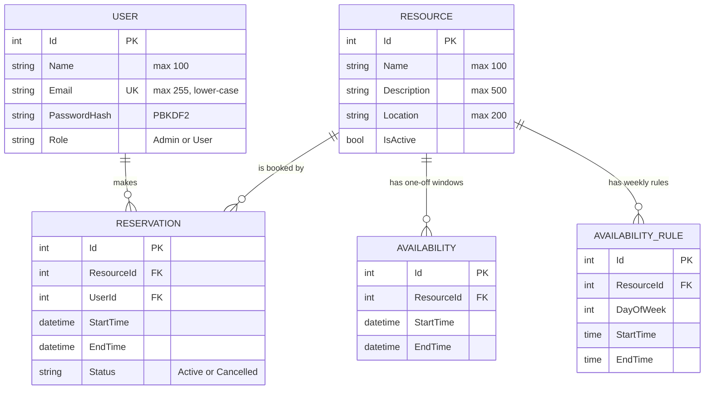
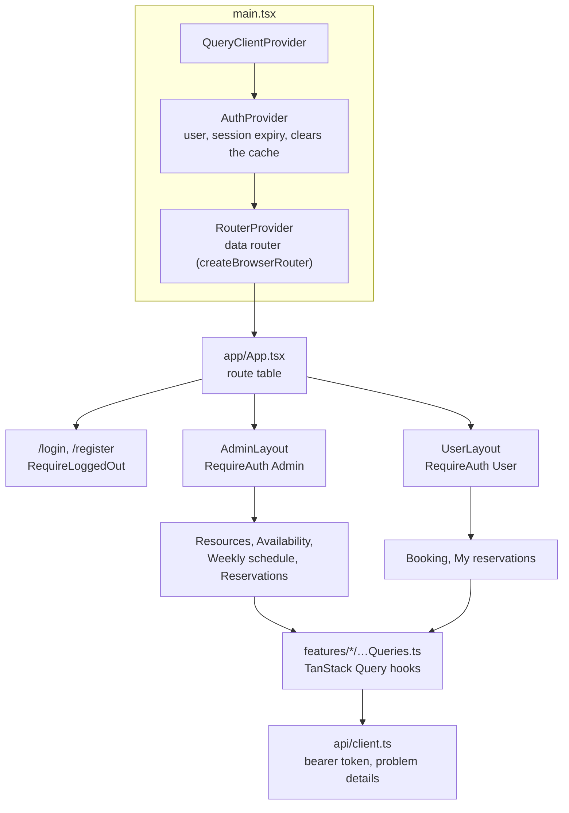

# Architecture

The Resource Reservation System is a React single-page app backed by an ASP.NET Core Web API and SQL Server. The API owns every business rule. The frontend only presents data and collects input.

## System overview

## Backend layers

| Layer | Folder | Responsibility |
|---|---|---|
| Controllers | `Controllers/` | Routing, `[Authorize]` rules, reading the current user from the token, and turning service results into HTTP responses |
| Services | `Services/` | Business rules: availability, booking, cancellation, authentication, tokens and scheduling time |
| Data | `Data/`, `Models/`, `Migrations/` | EF Core model, database constraints and migrations |
| Contracts | `DTOs/` | Request and response shapes, with DataAnnotations validation |
| Configuration | `Configuration/` | Typed settings, validated when the app starts |

### Services return results, not exceptions

Services return `ServiceResult<T>`, which holds either a value or a `ServiceError`. The error has a kind (`Validation`, `Unauthorized`, `NotFound`, `Forbidden`, `Conflict` or `Unavailable`) and a message.

One controller extension, `ToErrorResult`, maps each kind to an HTTP status and an RFC 9457 problem details response. Exceptions are kept for real bugs. The global exception handler logs them and returns a 500 that leaks no internal details. See [ADR 0003](adr/0003-error-handling.md).

Services get the caller as a plain `CurrentUser(UserId, IsAdmin)` value, so they never depend on HTTP.

### Thin CRUD controllers

`ResourcesController`, `AvailabilitiesController` and `AvailabilityRulesController` still call EF Core directly. Their logic is simple create, read, update and delete with small overlap checks, so a service layer for them would add files without adding value. They return errors through the same `ToErrorResult` helper, so every error response has the same shape.

## Creating a reservation

The most important flow. The per-resource lock is what prevents double-booking ([ADR 0002](adr/0002-reservation-concurrency.md)).

## Data model

The database enforces the integrity rules as well:

- a unique, normalised email
- a check constraint on reservation status
- an index for the overlap query
- `RESTRICT` on reservation foreign keys, so deleting a user or resource can never remove booking history

All times are wall-clock times in the configured scheduling time zone, `Europe/Copenhagen` ([ADR 0001](adr/0001-time-zone-convention.md)).

## Cross-cutting concerns

| Concern | How it works |
|---|---|
| Authentication | JWT bearer tokens signed with HMAC-SHA256. They last `Jwt:ExpiryMinutes` (120 by default). |
| Authorization | `[Authorize]` and `[Authorize(Roles = "Admin")]` on controllers. Services check ownership. |
| Errors | RFC 9457 problem details for every error, with `traceId` |
| Configuration | Typed options validated at startup. See [configuration](configuration.md). |
| Security | Rate-limited login and registration, CORS, trusted proxies, security headers and HSTS. See [security](security.md). |
| Health | `/health/live` and `/health/ready` for the hosting platform. See [deployment](deployment.md#health-checks). |
| Time | `SchedulingClock` gives "now" in the scheduling time zone, through an injectable `TimeProvider` |

## Request pipeline

Middleware runs in this order for every request:

1. **Forwarded headers:** only when trusted proxies are configured. They set the real client IP address and scheme.
2. **Exception handler:** turns unhandled exceptions into a 500 problem response.
3. **HSTS:** outside Development only.
4. **Security headers:** added when the response starts, so they're present on every response.
5. **Swagger:** Development only.
6. **HTTPS redirection**
7. **CORS**
8. **Rate limiter:** after CORS, so the browser can read a 429. It only applies to the auth endpoints.
9. **Authentication and authorization**
10. **Endpoints:** the controllers and health checks.

## Frontend

The frontend is a Vite-built React and TypeScript app. Routing uses React Router, server data uses TanStack Query, and each feature owns its screens and state ([ADR 0006](adr/0006-frontend-routing-and-state.md)).

| Folder | Contents |
|---|---|
| `src/app/` | The route table, the two layouts, route guards, the not-found page and the query client defaults |
| `src/auth/` | Session storage, `AuthProvider` and `useAuth`, and the login and registration page |
| `src/features/` | One folder per feature: `resources`, `availability`, `weekly-schedule`, `reservations`, `booking`. Each has its page components and its query hooks. |
| `src/components/` | App-specific sections built from `src/ui/`: forms, lists, the tabs, and `ConfirmProvider` |
| `src/ui/` | The design system's components: `Button`, `Field`, `Card`, `Alert`, `Badge`, `ConfirmDialog` and others, each with its stylesheet |
| `src/styles/` | Design tokens (`tokens.css`) and element defaults (`base.css`) |
| `src/lib/` | Pure helpers: dates, validation, schedule grouping, errors, navigation, query keys |
| `src/api/` | Typed API calls and the shared `client.ts` |

How state is handled:

- **Server data** is cached by query key. Each change invalidates the data it affects and resolves once the data on screen has reloaded. For example, cancelling a reservation refreshes the reservation lists and the booking schedules.
- **Logging in or out**, or a session expiring, clears the cache.
- **Filters and the booking selection** live in the address, such as `/book?resource=3&from=2030-01-14&to=2030-01-20`. A reload or a shared link shows the same view, and invalid values are ignored.
- **Form drafts and messages** belong to the page that shows them.
- **Redirects around login and logout** are made only by the route guards (`RequireAuth`, `RequireLoggedOut`), and `returnTo` must be a path inside the app.

### Design system

Styles are plain CSS. Colours, spacing, type, radii and shadows are custom properties in `styles/tokens.css`, with a dark theme. Each component in `src/ui/` has its own stylesheet and uses only tokens ([ADR 0007](adr/0007-design-system.md)).

- **Forms** use `Field`, which links the label, hint and error to the control. API validation errors are shown beside their fields: `ApiError.fieldErrors` holds the first message for each field, and `getFormErrors` splits them from messages for the whole form. After a failed submit, focus moves to the first invalid field.
- **Messages** are `Alert`s with a tone. Errors are announced at once (`role="alert"`), other messages politely (`role="status"`).
- **The confirmation dialog** follows the WAI-ARIA alert dialog pattern, and the page behind it is inert.
- **The layout** has a skip link to `<main id="main-content">`, one `h1` per page, and a document title for the current screen.
- **Dates** come from `lib/dates.ts` in `en-GB` with a 24-hour clock, read from the API's wall-clock text rather than through the browser's time zone.

## Decision records

- [ADR 0001: Store times as wall-clock time in one configured time zone](adr/0001-time-zone-convention.md)
- [ADR 0002: Serialize bookings per resource with a SQL Server application lock](adr/0002-reservation-concurrency.md)
- [ADR 0003: Problem details for errors and result types for expected failures](adr/0003-error-handling.md)
- [ADR 0004: Keep the token in localStorage and handle session expiry in the frontend](adr/0004-token-storage-and-session-expiry.md)
- [ADR 0005: Database migrations as a separate deployment step](adr/0005-migrations-in-deployment.md)
- [ADR 0006: Frontend routing and server state](adr/0006-frontend-routing-and-state.md)
- [ADR 0007: Plain CSS with design tokens and shared components](adr/0007-design-system.md)
