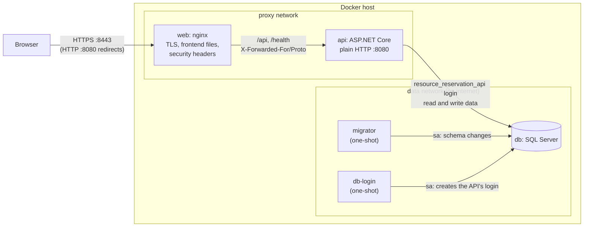

# Deployment

The project isn't hosted. Milestone 7 makes it deploy-ready: the whole system runs with Docker Compose, from three images and a compose file, on any machine with Docker. There is no hosted demo.

Milestone 7 is three pull requests ([roadmap](roadmap.md#m7-deployment)). This guide describes the first one, the containers. Until the other two are merged:

- **Emails aren't sent.** They are written to a volume ([reading emails](#reading-emails)), so new users can't confirm their accounts without an operator's help. Real email delivery comes in PR 3.
- **Images are built locally.** PR 3 publishes them to the GitHub container registry.

Don't run a public deployment before PR 3 is done.

## Topology



The frontend and the API share one origin. nginx serves the built frontend and passes `/api` and `/health` to the API, so the browser never makes a cross-origin request and `Cors:AllowedOrigins` stays empty.

| Service | Image | What it does | Ports on the host |
|---|---|---|---|
| `db` | `mcr.microsoft.com/mssql/server:2022-latest` | SQL Server, with its data in the `db-data` volume | None |
| `migrator` | `resource-reservation-migrator`, from `backend/Dockerfile` | Applies pending migrations with the migration bundle, then exits ([ADR 0005](adr/0005-migrations-in-deployment.md)) | None |
| `db-login` | The SQL Server image, for its `sqlcmd` | Creates or updates the API's own SQL login, then exits | None |
| `api` | `resource-reservation-api`, from `backend/Dockerfile` | The API, on plain HTTP port 8080 | None |
| `web` | `resource-reservation-web`, from `frontend/resource-reservation-client/Dockerfile` | nginx: TLS, the frontend, the proxy to the API | `HTTP_PORT` and `HTTPS_PORT`, on `BIND_ADDRESS` |

They start in order. Each waits until the one before is ready:

1. `db` answers a query.
2. `migrator` has applied the migrations and exited successfully.
3. `db-login` has created the login and exited successfully.
4. `api` returns `200` from `/health/ready`.
5. `web` starts.

If a step fails, the steps after it don't start, and `docker compose up` reports which one failed.

## Quick start on your own machine

You need Docker with Compose v2, about 2 GB of memory for SQL Server, and `openssl`, which comes with Git Bash on Windows, macOS and Linux. SQL Server's image is x64 only. On Apple silicon, Docker Desktop runs it through emulation.

```bash
cp .env.example .env
```

Fill in the three secrets in `.env`, each generated separately, for example with `openssl rand -base64 24`. Set `SEED_ADMIN_EMAIL` and `SEED_ADMIN_PASSWORD` to get a first admin account. Then:

```bash
sh deploy/create-dev-certificate.sh
docker compose up --build
```

Open <https://localhost:8443>. The browser warns about the self-signed certificate once. For a certificate your browser trusts, create one with [mkcert](https://github.com/FiloSottile/mkcert) instead:

```bash
mkcert -install
mkcert -cert-file certs/tls.crt -key-file certs/tls.key localhost 127.0.0.1
```

To check the running stack from outside:

```bash
sh deploy/smoke-test.sh
```

It checks the redirect to HTTPS, the security and cache headers, that the Content-Security-Policy allows exactly the inline script in the served page, the SPA fallback, the proxy to the API, and that the API trusts nginx's forwarded headers. If the seed admin is set, it also:

- gets a bearer token, and creates and deletes a resource with it
- signs in as a browser over HTTPS, and checks the session cookie's attributes and that the response holds no token
- checks that sign-in without an anti-forgery token, a forged token and a cross-site request are refused
- checks that signing out revokes the session, so a copy of the cookie stops working

CI runs the same checks on every push.

`docker compose down` stops everything and keeps the data. `docker compose down --volumes` also deletes the database, the emails and the Data Protection keys.

### Reading emails

Until PR 3 adds real email delivery, the API writes each email as an `.eml` file to the `api-emails` volume. To read them:

```bash
docker compose exec api ls /var/lib/resource-reservation/emails
docker compose cp api:/var/lib/resource-reservation/emails ./compose-emails
```

Open a file in any mail client. The files contain working verification and reset links, so treat them as secrets and delete the copy afterwards.

## HTTPS

TLS ends at nginx, in every environment, including your own machine:

- **Why locally too:** the session cookie has the `__Host-` prefix, which browsers accept only with the `Secure` attribute, over HTTPS ([ADR 0012](adr/0012-cookie-sessions-and-csrf.md)). Browsers disagree about whether plain `http://localhost` counts, so the stack uses HTTPS everywhere and behaves the same locally as in production.
- **Plain HTTP** on `HTTP_PORT` only redirects to `PUBLIC_ORIGIN`, keeping the path. The redirect goes to the configured origin, never to the `Host` header a client sent.
- **Certificates:** nginx reads `tls.crt` (with any intermediate certificates after it) and `tls.key` from `TLS_CERT_DIR`, mounted read-only. nginx runs as user 101, which must be able to read the key. The container won't start without both files, or without an `https://` `PUBLIC_ORIGIN`.
- **Renewing a certificate:** replace the files, then run `docker compose exec web nginx -s reload`. With Let's Encrypt, point `TLS_CERT_DIR` at a folder that certbot's deploy hook copies `fullchain.pem` and `privkey.pem` into as `tls.crt` and `tls.key`.
- **Protocols:** TLS 1.2 and 1.3 only, with HTTP/2.
- **HSTS:** nginx sends `Strict-Transport-Security: max-age=31536000` on the frontend's responses, and the API on its own. Both leave it out for `localhost`, where it would also force HTTPS on every other local port, such as the Vite dev server.
- **The API doesn't redirect.** `UseHttpsRedirection` only redirects when the API knows an HTTPS port. Here it doesn't, so leave `ASPNETCORE_HTTPS_PORT` and `ASPNETCORE_HTTPS_PORTS` unset. The API logs a warning at startup that it can't find the port. That warning is expected. If the API also redirected, a misconfigured proxy would cause a redirect loop.

**A load balancer in front of nginx** isn't supported out of the box. nginx assumes it is the first proxy: it replaces any `X-Forwarded-For` a client sends with the address it sees. Behind another proxy, every client would then share that proxy's address and one rate limit. That setup needs nginx's `real_ip` module, trusting only the load balancer's address.

## Trusting the reverse proxy

The API takes the client's IP address and scheme from `X-Forwarded-For` and `X-Forwarded-Proto`, but only from addresses in `ReverseProxy:KnownProxies` or `ReverseProxy:KnownNetworks`. Compose trusts exactly one address, nginx's:

- **nginx has a fixed address,** `PROXY_IP` (`172.31.250.10` by default), on the `proxy` network. Docker gives every other container an address from `PROXY_IP_RANGE`, which doesn't include it, so no other container can take it, even while nginx is down.
- **The API trusts only that address,** through `ReverseProxy__KnownProxies__0`. The same headers from any other container are ignored. This was checked by sending them from inside the stack. The API saw `http`, while the same request through nginx saw `https`.
- **nginx replaces the headers rather than adding to them.** `X-Forwarded-For` is set to the address nginx sees, so a client can't add its own entries. `X-Forwarded-Host` and `X-Forwarded-Prefix` are removed.
- **The `Host` header** is passed on as the browser sent it, port included, so links the API builds, such as `Location` headers, point at the public address.

**Don't set `ASPNETCORE_FORWARDEDHEADERS_ENABLED`.** It makes the API trust forwarded headers from any address, which lets clients fake their IP address and get around the rate limit.

If no proxy is configured, the API still works, but every client appears to have the proxy's IP address. All users then share one login rate limit, and the API's HSTS isn't sent.

To change the network's addresses, for example because the subnet clashes with another network, change `PROXY_SUBNET`, `PROXY_IP_RANGE` and `PROXY_IP` together. Compose refuses to start if `PROXY_IP` is outside the subnet.

## The frontend's responses

nginx sets these on every frontend response. API responses keep the API's own headers ([security](security.md#transport-and-response-headers)).

| Header | Value | Why |
|---|---|---|
| `Content-Security-Policy` | `default-src 'none'; script-src 'self' 'sha256-…'; style-src 'self'; img-src 'self'; font-src 'self'; connect-src 'self'; manifest-src 'self'; base-uri 'none'; form-action 'self'; frame-ancestors 'none'` | Only the app's own files can load or run. The one inline script, which applies the saved theme before the page draws, is allowed by its hash. |
| `X-Content-Type-Options` | `nosniff` | Browsers must not guess a different content type |
| `X-Frame-Options` | `DENY` | No framing (clickjacking), for browsers that don't support `frame-ancestors` |
| `Referrer-Policy` | `no-referrer` | The same as the API |
| `Permissions-Policy` | `camera=(), microphone=(), geolocation=(), payment=(), usb=()` | The app uses none of these |
| `Cross-Origin-Opener-Policy` | `same-origin` | Other sites' windows can't reach this one |
| `Strict-Transport-Security` | `max-age=31536000`, except on `localhost` | See [HTTPS](#https) |

**The theme script's hash** is computed when the image is built, from the built `index.html` (`scripts/csp-script-hashes.mjs`), and written into the policy. Changing the script can't break the policy, and no other inline script can run. The hash is taken after turning Windows line endings into `\n`, as browsers do. Without that step, an image built from a Windows checkout had a hash that browsers rejected. The smoke test checks that the policy matches the served page.

**Caching:**

- **Files in `/assets/`** have a content hash in their names, so they are cached for a year as `immutable`. A missing file there is a `404`, never `index.html`.
- **`index.html`** is sent with `Cache-Control: no-cache`, so the browser checks for a new version on every load and picks up a release straight away.

**Routes:** any other path that isn't a file gets `index.html`, so addresses such as `/admin/users` work when reloaded. The app shows its own not-found page for unknown routes.

**Compression:** nginx compresses the frontend's files, but not API responses. Compressing responses that contain secrets, such as tokens, alongside text an attacker can influence, risks the BREACH attack.

## Secrets

- **They are in `.env`,** which git ignores. `.env.example` lists the settings, with every secret left blank. Generate each secret separately.
- **Passwords** must not contain `'`, `;`, `"` or `$`, which would break the connection strings, the login script or the compose file. `openssl rand -base64 24` never produces them, and its output meets SQL Server's password rules.
- **The images contain no secrets.** `.dockerignore` keeps `appsettings.Development.json`, with its development key and seed password, `.env` files and the certificates out of every build. The API image contains only `appsettings.json`.
- **Containers get secrets as environment variables.** Anyone who can run `docker inspect` on the host can read them, so only administrators should have Docker access.
- **The private key** is mounted into nginx at runtime, never built into the image.

## The database

- **SQL Server isn't published on the host.** Only containers on the `data` network can reach it, and that network has no internet access.
- **Edition:** `MSSQL_PID` defaults to `Express`, which is free for production but limits a database to 10 GB. Set your licensed edition otherwise. Don't use `Developer` in production, because its licence doesn't allow it.
- **Two logins:**
  - `sa` is used only by the `migrator` and `db-login` steps.
  - The API connects as `resource_reservation_api`, which can read and write data but can't change the schema (`db_datareader` and `db_datawriter`). `deploy/sql/app-login.sql` creates it after every migration, and sets its password from `APP_DB_PASSWORD` again, which is how to change that password.
- **Encryption:** connections inside the stack are encrypted, but trust SQL Server's self-signed certificate (`TrustServerCertificate=True`). For a SQL Server outside the stack, use a certificate the client can check, and remove that setting.
- **Using your own SQL Server** instead of the container: remove the `db` service, and point the connection strings in `compose.yaml` at your server. Use a login with schema rights for `migrator` and `db-login`, and keep the API's login limited.

**Backups:** the `db-data` volume holds the database files. Back up with SQL Server itself, for example:

```bash
docker compose exec db bash -c '/opt/mssql-tools18/bin/sqlcmd -S localhost -U sa -P "$MSSQL_SA_PASSWORD" -C -Q "BACKUP DATABASE ResourceReservation TO DISK = N'"'"'/var/opt/mssql/backup/rr.bak'"'"' WITH INIT"'
docker compose cp db:/var/opt/mssql/backup/rr.bak ./rr.bak
```

Store the copy off the host.

## Running on a server

The same `compose.yaml` runs in production. Differences from the quick start:

- `PUBLIC_ORIGIN` is the public address, such as `https://reservations.example.com`. It is also used for the links in emails.
- `BIND_ADDRESS=0.0.0.0`, `HTTP_PORT=80` and `HTTPS_PORT=443`, so the site is reachable from outside. The default, `127.0.0.1`, keeps it on the machine itself.
- `TLS_CERT_DIR` points at a real certificate.
- `SEED_ADMIN_EMAIL` and `SEED_ADMIN_PASSWORD` are removed after the first sign-in, and that admin changes their password.
- Only ports 80 and 443 are open in the server's firewall. Docker's published ports bypass some host firewalls, such as `ufw`, so keep `BIND_ADDRESS` as narrow as possible.

## Releasing a new version

1. **Back up the database** ([backups](#the-database)).
2. **Build or pull the new images:** `docker compose build`, or `docker compose pull` once images are published (PR 3).
3. **Run `docker compose up -d`.** Compose runs `migrator` and `db-login` again, and only recreates the API once both have succeeded. `/health/ready` must return `200` before nginx is recreated.
4. **Run `sh deploy/smoke-test.sh`.**

A migration must still work with the API version that is running while it applies. Split breaking schema changes over two releases: first add the new structure, then remove the old one once no running version uses it.

## Database migrations

Migrations are applied as a separate deployment step, never by the API at startup ([ADR 0005](adr/0005-migrations-in-deployment.md)). In compose, that step is the `migrator` container, which runs the migration bundle and exits.

CI also builds the bundle on its own on every push. It applies the bundle to an empty SQL Server to prove it works, and uploads it as the `efbundle-linux-x64` artifact. To run that bundle outside compose:

```bash
chmod +x efbundle   # GitHub artifacts don't keep the executable permission
./efbundle --connection "Server=...;Database=...;User Id=...;Password=..."
```

The connection string can also come from the `ConnectionStrings__DefaultConnection` environment variable, which is how the `migrator` container gets it.

How the bundle behaves:

- **Only missing migrations are applied.** Running it on an up-to-date database changes nothing.
- **Runs can't overlap.** EF Core takes a database lock, so two runs at the same time apply each migration only once.
- **The login can differ from the API's.** The bundle needs rights to change the schema. The API's own login only needs to read and write data.
- **Build it locally** for another platform with:

```bash
dotnet tool restore
dotnet restore backend/ResourceReservation.Api
dotnet ef migrations bundle --project backend/ResourceReservation.Api --startup-project backend/ResourceReservation.Api --configuration Release --self-contained --target-runtime linux-x64 --output efbundle
```

The EF tools don't start the API. They use `AppDbContextDesignTimeFactory`, which only needs a connection string.

## Health checks

| Endpoint | Use for | Checks |
|---|---|---|
| `/health/live` | Liveness: restart the container if this fails | The process responds. No database check, so a database outage doesn't cause restarts. |
| `/health/ready` | Readiness: send traffic only while this is `200` | The database is reachable. Returns `503` if not. |

Both are anonymous and return only `Healthy` or `Unhealthy`. nginx passes them through, so they can be checked from outside. Compose uses `/health/ready` for the API's health check. The API image has no `curl`, so the check sends the request with `bash`.

## The containers

- **Non-root:** the API and migrator run as the .NET images' `app` user (uid 1654), and nginx as `nginx` (uid 101). The API listens on 8080 and nginx on 8080 and 8443, so none of them needs root.
- **Hardening:** every service but SQL Server drops all Linux capabilities and can't gain privileges (`no-new-privileges`). The API's file system is read-only, except `/tmp`, the email volume and the `api-keys` volume for the Data Protection keys.
- **Restart policy:** `unless-stopped` for the long-running services. The one-shot steps never restart.
- **Logs** go to standard output, so `docker compose logs` shows them. The API no longer logs every SQL command, only warnings and errors from EF Core.

## Configuration

`.env.example` describes every setting compose reads. The API's own settings are in [configuration](configuration.md#docker-compose). At minimum, a deployment needs:

- `PUBLIC_ORIGIN`
- `MSSQL_SA_PASSWORD`, `APP_DB_PASSWORD` and `JWT_KEY`
- `EMAIL_FROM_ADDRESS`
- A certificate in `TLS_CERT_DIR`

Never run production with `ASPNETCORE_ENVIRONMENT=Development`. That would load the development settings and seed demo data. The images don't contain the development settings, and default to `Production`.

## Known limitations

- **No email is sent yet.** Emails go to a volume until Milestone 7 PR 3 adds SMTP delivery.
- **Data Protection keys are stored unencrypted** in the `api-keys` volume. They protect the anti-forgery tokens. Anyone who can read the volume could forge such a token, but would still need the victim's httpOnly session cookie. Keep Docker access to administrators. When it creates a key, the API logs a warning that no key encryptor is configured, which is expected.
- **Expired sessions stay** in the `UserSessions` table, one row per sign-in. A clean-up job comes in PR 3.
- **Booking emails accumulate** in the `BookingNotifications` table after they are sent. Nothing removes them yet. A clean-up job comes in PR 3.
- **Booking emails are delivered at least once, not exactly once.** Stopping the API between sending an email and recording it sends that email again after the 5-minute lease. Gives-ups are logged as errors, and kept in the table with `FailedAt` and `LastError`.
- **Account emails are queued in memory.** A verification or reset email still queued when the API stops is lost, and the user asks again. `docker compose stop` stops the API gracefully.
- **One API instance.** Rate limit counters are in memory, per instance, so several instances would each count separately. A shared store such as Redis would be needed.
- **Images are x64 only,** like SQL Server's.
