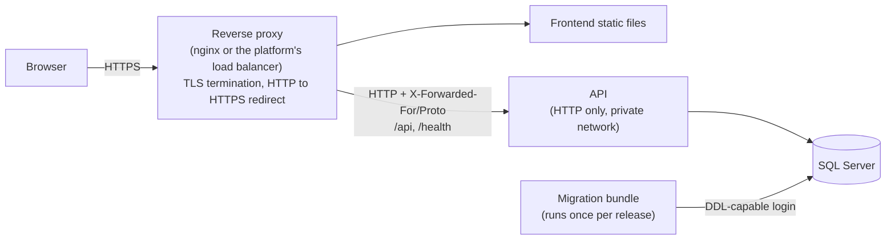

# Deployment

The project isn't hosted. Milestone 7 makes it deploy-ready, with Docker Compose and published images, but no hosted demo. This guide describes what the application already expects from any deployment, so that work only has to wire it up.

## Planned topology



## HTTPS termination and redirection

HTTPS ends at the reverse proxy, not at the API.

- **The proxy** holds the certificate. It redirects HTTP to HTTPS for every request, and sends HSTS for the frontend's pages.
- **The API** listens on plain HTTP, reachable only from the proxy. It learns that the original request was HTTPS from `X-Forwarded-Proto`, and it accepts that header only from the addresses in `ReverseProxy:KnownProxies` or `ReverseProxy:KnownNetworks`. On requests it sees as HTTPS, outside Development, it sends HSTS itself.
- **The API does not redirect.** `UseHttpsRedirection` only redirects when the API knows an HTTPS port. In this setup it doesn't, so leave `ASPNETCORE_HTTPS_PORT` and `ASPNETCORE_HTTPS_PORTS` unset. If the API also redirected, a misconfigured proxy would cause a redirect loop.
- **Don't set `ASPNETCORE_FORWARDEDHEADERS_ENABLED`.** It makes the API trust forwarded headers from any address, which lets clients fake their IP address and get around the rate limit.

If the proxy isn't configured as trusted, the API still works, but every client appears to have the proxy's IP address. All users then share one login rate limit, and HSTS isn't sent.

## Releasing a new version

1. **Back up the database.**
2. **Apply migrations** with the migration bundle (see below), before the new API version starts.
3. **Deploy the API.** Wait until `/health/ready` returns `200`.
4. **Deploy the frontend**, built with `VITE_API_BASE_URL` pointing at the API.

The old API version keeps running while step 2 runs, so a migration must still work with the old version. Split breaking schema changes over two releases: first add the new structure, then remove the old one once no running version uses it.

## Database migrations

Migrations are applied as a separate deployment step, never by the API at startup ([ADR 0005](adr/0005-migrations-in-deployment.md)).

CI builds a self-contained Linux **migration bundle** on every push. It applies the bundle to an empty SQL Server to prove it works, and uploads it as the `efbundle-linux-x64` artifact. To run it:

```bash
chmod +x efbundle   # GitHub artifacts don't keep the executable permission
./efbundle --connection "Server=...;Database=...;User Id=...;Password=..."
```

The connection string can also come from the `ConnectionStrings__DefaultConnection` environment variable.

How the bundle behaves:

- **Only missing migrations are applied.** Running it on an up-to-date database changes nothing.
- **Runs can't overlap.** EF Core takes a database lock, so two runs at the same time apply each migration only once.
- **The login can differ from the API's.** The bundle needs rights to change the schema. The API's own login only needs to read and write data.
- **Build it locally** for another platform with:

```bash
dotnet tool restore
dotnet restore backend/ResourceReservation.Api
dotnet ef migrations bundle --project backend/ResourceReservation.Api --startup-project backend/ResourceReservation.Api --configuration Release --self-contained --target-runtime linux-x64 --output efbundle
```

The EF tools don't start the API. They use `AppDbContextDesignTimeFactory`, which only needs a connection string.

## Health checks

| Endpoint | Use for | Checks |
|---|---|---|
| `/health/live` | Liveness: restart the container if this fails | The process responds. No database check, so a database outage doesn't cause restarts. |
| `/health/ready` | Readiness: send traffic only while this is `200` | The database is reachable. Returns `503` if not. |

Both are anonymous and return only `Healthy` or `Unhealthy`.

## Configuration

Every setting is described in [configuration](configuration.md). At minimum, production needs:

- `ConnectionStrings:DefaultConnection`
- `Jwt:Key`, `Jwt:Issuer` and `Jwt:Audience`, with the key kept in the platform's secret store
- `ReverseProxy:KnownProxies` or `ReverseProxy:KnownNetworks`
- `Cors:AllowedOrigins`, only if the frontend is on another origin
- `Email:Delivery`, `Email:FromAddress` and `Frontend:BaseUrl`. The API doesn't start without them. Until Milestone 7 adds a real email provider, the only delivery option writes emails to a folder ([configuration](configuration.md#email)).

Never run production with `ASPNETCORE_ENVIRONMENT=Development`. That would load the committed development key and seed password, enable Swagger, and seed demo data.

## Known limitations

- **Booking emails accumulate** in the `BookingNotifications` table after they are sent. Nothing removes them yet.
- **Booking emails are delivered at least once, not exactly once.** Stopping the API between sending an email and recording it sends that email again after the 5-minute lease. Gives-ups are logged as errors, and kept in the table with `FailedAt` and `LastError`.
- **Account emails are queued in memory.** A verification or reset email still queued when the API stops is lost, and the user asks again. Stop the API gracefully where possible.
- **Rate limit counters are in memory**, per API instance. With several instances, each one counts separately. A shared store such as Redis would be needed.
- **The frontend's own security headers** (Content-Security-Policy and others for its pages) must be set by whatever serves the static files. That is part of Milestone 7.
- **Token storage:** the JWT is kept in `localStorage`. Before any public deployment, review moving to httpOnly cookies. This is tracked in the roadmap for Milestone 7.
